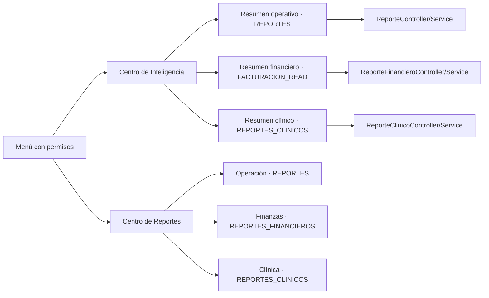

# Auditoría del Centro de Inteligencia y Reportes

Estado: auditoría inicial y primera iteración implementada. No se retiraron endpoints ni
funciones transaccionales. Los reportes siguen calculándose en sus servicios de dominio y el
catálogo solo descubre las vistas disponibles; no ejecuta consultas al abrirse.

## Diagnóstico ejecutivo

La aplicación tiene tres dominios analíticos reales y separados: operación del consultorio,
finanzas y actividad clínica. No son dashboards intercambiables y no deben combinarse en una
consulta que ignore permisos. Sí hay solapamiento parcial: el inicio y las estadísticas
operativas repiten citas, cancelaciones y rankings; el dashboard financiero y Ventas repiten
totales del mismo libro de movimientos. La clínica aporta información distinta y especializada.

La consolidación segura es centralizar el descubrimiento y la navegación, compartir filtros y
componentes gradualmente y mantener endpoints, fórmulas y permisos por dominio. Esta iteración
convierte `/dashboard` en un hub sin consultas, mantiene la vista operativa en `/dashboard/operacion`,
centraliza el catálogo en `/reportes`, conserva estadísticas en `/reportes/operacion`, corrige el
acceso al resumen financiero y deja intactas las operaciones de cuentas, caja y comprobantes.

## Inventario de pantallas y decisiones

| Módulo actual | Funcionalidad e información | Fuente | Acceso efectivo | Duplicación | Decisión | Riesgo |
|---|---|---|---|---|---|---|
| Centro de Inteligencia `/dashboard` | Descubre paneles Operación, Finanzas y Clínica según permisos; no consulta indicadores en el hub | Metadatos frontend y `AuthService.puede()`; los destinos usan APIs existentes | `REPORTES`, `FACTURACION_READ` o `REPORTES_CLINICOS` según panel | Centraliza acceso, no datos | Punto de entrada común; paneles siguen lazy por navegación | El filtro frontend mejora UX; el backend conserva autorización efectiva |
| Resumen operativo `/dashboard/operacion` | Citas de hoy, confirmaciones, pendientes, pacientes nuevos, conversaciones, mensajes; tendencias, cancelaciones e inasistencias, rankings | `GET /reportes/dashboard`, `GET /reportes/estadisticas` | `REPORTES`; `ADMIN`, `SUPER_ADMIN`, `RECEPCION` | Parcial con estadísticas operativas | Mantener como vista ejecutiva de operación | Usa dos consultas al cargar; mensajes/notificaciones son conteos acumulados, no del período |
| Estadísticas operativas `/reportes/operacion` | Citas por día/estado, confirmaciones, cancelaciones, inasistencia, odontólogo, servicio y fuente | `GET /reportes/estadisticas` | `REPORTES`; `ADMIN`, `SUPER_ADMIN`, `RECEPCION` | Parcial con resumen operativo | Mantener como consulta detallada, accesible desde el catálogo | Algunas series incluyen citas de todos los estados; su significado debe mostrarse explícitamente |
| Catálogo `/reportes` | Búsqueda por texto y filtro de dominio; metadatos de reportes autorizados | Metadatos frontend; sin consulta analítica | Entrada visible si tiene `REPORTES`, `REPORTES_FINANCIEROS` o `REPORTES_CLINICOS`; cada destino valida su propio permiso | Reemplaza solo la lista dispersa | Consolidar descubrimiento sin fusionar las consultas | La visibilidad frontend no reemplaza la autorización backend |
| Reportes clínicos `/reportes-clinicos` | Totales, diagnósticos, pendientes actuales, continuidad y producción clínica | `GET /historia-clinica/reportes` | `REPORTES_CLINICOS`; `SUPER_ADMIN`, `ADMIN`, `ODONTOLOGO` | Sin duplicación semántica confirmada | Mantener como dominio especializado; registrar en el catálogo | Mezcla métricas de rango con pendientes en estado actual; no exporta el reporte global |
| PDF de historia individual `/pacientes/:id/historia` | Historia clínica completa descargable en PDF | `GET /historia-clinica/pacientes/{id}/reportes/historia-completa.pdf` | `REPORTES_CLINICOS`, también validado en backend | No es el reporte clínico agregado | Mantener como exportación contextual desde el expediente | Contiene datos clínicos sensibles; no trasladar a una exportación global sin análisis adicional |
| Dashboard financiero `/facturacion` | Cargos, cobros, saldo, anticipos, ticket, descuentos, período, hoy/mes; tendencia y comparación cuando hay permiso detallado | `GET /facturacion/dashboard`; reportes de ventas comparables solo para `REPORTES_FINANCIEROS` | Resumen: `FACTURACION_READ`; detalle: `REPORTES_FINANCIEROS` | Parcial con Ventas | Mantener como visión ejecutiva; no incluir en reportes si el perfil no está autorizado | El nombre “facturado” significa cargos, no facturas SRI; proyecciones frontend son escenarios, no cifras oficiales |
| Reportes financieros `/facturacion/reportes` | Ventas diarias/medios, producción odontólogo, saldos, sesiones de caja | `/facturacion/reportes/{ventas,produccion,saldos,caja}` | `REPORTES_FINANCIEROS`; `SUPER_ADMIN`, `ADMIN` | Parcial con dashboard financiero | Mantener detalle y conciliación; acceso agrupado en catálogo | Servicio carga movimientos/cuentas en memoria; exportación CSV/XLSX no implementada |
| Cuentas `/facturacion/cuentas` | Gestión de saldo y libro de cargos, descuentos, abonos, anticipos y devoluciones | `/facturacion/cuentas`, `/facturacion/cuentas/{id}` y mutaciones | `FACTURACION_READ/WRITE`; `SUPER_ADMIN`, `ADMIN`, `RECEPCION` | No es un reporte; comparte cifras con finanzas | Mantener como flujo transaccional | No retirar ni reemplazar por dashboard |
| Caja `/facturacion/caja` | Sesiones, movimientos, apertura y cierre | `/facturacion/cajas/**` | `CAJA_READ/WRITE/CERRAR` según acción | El reporte de caja resume estas sesiones | Mantener operaciones; reporte sigue siendo lectura agregada | El reporte no sustituye el cierre operativo |
| Comprobantes `/facturacion/comprobantes` | Bandeja, SRI, detalle, XML/RIDE, reenvío/anulación/notas de crédito | `/facturacion/comprobantes/**` | `FACTURACION_READ`, `FACTURACION_EMITIR`, `FACTURACION_ANULAR` | No es dashboard ni reporte agregado | Mantener separado como operación tributaria | No confundir cargos de cuenta con comprobantes autorizados |

## Rutas, componentes y reutilización

| Superficie | Implementación actual | Decisión |
|---|---|---|
| Rutas | `app.routes.ts`: hub y vistas de dominio lazy-loaded | `/dashboard` es hub; resumen operativo está en `/dashboard/operacion`; `/reportes` es catálogo; la ruta previa de estadísticas continúa en `/reportes/operacion`; destinos financiero y clínico siguen |
| Menú/permiso | `MENU`, `SidebarComponent`, `AuthService.puede()` | El catálogo aparece con cualquiera de los permisos de reportes; cada entrada interna usa su permiso exacto |
| Consulta HTTP | `Api`, `withLoading`, servicios/componentes por módulo | No crear un servicio monolítico; centralizar solo filtros/formatos cuando se reutilicen |
| Componentes UI | `UiPageHeader`, `UiBadge`, `UiTable`, `UiPagination`, `UiModal` | Reutilizar; gráficos actuales son HTML/CSS, no se añade una librería |
| Tablas | `table.tbl`, `.tbl-wrap` y estilos globales | Scroll horizontal dentro de cada tabla; no alterar contratos tabulares |
| Exportaciones | PDF de historia completa; XML/RIDE tributarios; PDFs de artefactos clínicos individuales | No existe exportación general CSV/XLSX para estos reportes. El catálogo declara “Vista en pantalla”; no presenta botones de exportación inexistentes |

## Catálogo central actual

| Nombre | Dominio | Ruta de visualización | Filtros | Salida disponible | Permiso | Endpoint |
|---|---|---|---|---|---|---|
| Estadísticas de operación | Operación | `/reportes/operacion` | Fecha y límite de servicios | Pantalla | `REPORTES` | `/reportes/estadisticas` |
| Reportes financieros | Finanzas | `/facturacion/reportes` | Fecha para ventas/producción/caja; saldos actuales | Pantalla | `REPORTES_FINANCIEROS` | `/facturacion/reportes/{ventas,produccion,saldos,caja}` |
| Reportes clínicos | Clínica | `/reportes-clinicos` | Fecha y límite (1–50) | Pantalla | `REPORTES_CLINICOS` | `/historia-clinica/reportes` |

El PDF de historia individual permanece en su flujo contextual y no se presenta como exportación
del reporte clínico global.

## Roles y permisos verificados

| Perfil sembrado | Inicio/vistas de inteligencia existentes | Catálogo y reportes | Restricción importante |
|---|---|---|---|
| `SUPER_ADMIN` | Hub, operación, resumen financiero, financiero detallado y clínico | Todas las entradas | Backend verifica permiso en cada endpoint |
| `ADMIN` | Hub, operación, resumen financiero, financiero detallado y clínico | Todas las entradas | Igual que arriba |
| `RECEPCION` | Hub, operación (`REPORTES`) y resumen financiero (`FACTURACION_READ`) | Catálogo operativo y resumen; no finanzas detalladas ni clínica | La consulta de Ventas/saldos/caja detallada debe seguir en 403 |
| `ODONTOLOGO` | Hub y panel clínico (`REPORTES_CLINICOS`) | Catálogo clínico | El aterrizaje `/dashboard` es independiente del permiso de los paneles; el resumen operativo sigue en 403 y no se muestra en el hub |

No hay ámbitos de sucursal/área configurables en estos DTOs. Hibernate usa `@TenantId`; las
consultas nativas de citas incluyen `tenant_id` explícito y las consultas de entidades usan el
tenant activo. El catálogo únicamente filtra opciones; los endpoints siguen siendo la autoridad.

## Diccionario de KPI verificado

| KPI | Definición/fórmula en el código | Unidad, período y filtros | Nulos, anulados y límites |
|---|---|---|---|
| Citas de hoy | `countByFecha(hoy)` | Citas; fecha local `app.timezone` | Incluye todos los estados |
| Citas por día | Conteo de citas agrupado por `fecha` | Citas/día; `[desde,hasta]` | Incluye todos los estados; serie sin filas equivale a 0 en el frontend |
| Confirmaciones | Conteo `confirmada=true` agrupado por fecha | Citas; rango | Es confirmación, no necesariamente cita atendida |
| Cancelación / inasistencia | Conteos de estados `CANCELADA` / `NO_ASISTIO` | Citas; rango | Dashboard divide cada conteo por citas del período; si el denominador es 0, la UI muestra 0% |
| Pacientes nuevos del mes | Conteo con creación desde inicio de mes | Pacientes; mes actual | El dashboard presenta conteo, no crecimiento porcentual calculado |
| Conversaciones abiertas | Conversaciones en estados `BOT` o `ATENCION_HUMANA` | Conversaciones; estado actual | No es métrica de período |
| Mensajes/notificaciones | Conteos por estado `ENVIADO/ERROR` o `ENVIADA/ERROR` | Registros; acumulado/estado actual | No agrupar con intervalo de citas |
| Facturado (finanzas) | Suma de movimientos vigentes `CARGO.total` | Moneda; rango, hoy o mes | Antes de SRI equivale a cargo de cuenta, no a comprobante electrónico |
| Cobrado | `ABONO + ANTICIPO - DEVOLUCION` | Moneda; mismo rango de fecha de movimiento | Movimientos anulados excluidos; descuentos se reportan separados |
| Por cobrar | Suma de `saldo > 0` en cuentas | Moneda; estado actual, no rango histórico | Excluye créditos/saldos negativos y saldos cero |
| Ticket promedio | `cobrado / cobros`; cobros cuenta `ABONO + ANTICIPO` | Moneda/cobro; rango | Si `cobros=0`, backend devuelve 0; devoluciones reducen importe neto sin reducir el contador de cobros |
| Distribución por pago | Suma de ABONO/ANTICIPO menos DEVOLUCION, por forma | Moneda; rango | Forma nula se etiqueta `OTRO`; anulados excluidos |
| Crecimiento financiero en UI | `(facturado actual - facturado previo equivalente) / facturado previo * 100` | Porcentaje; intervalos calculados desde el rango | Si base anterior es 0/no existe, se omite; cálculo frontend sujeto a corrección de rango/calendario |
| Proyección 30 días en UI | `facturado del rango / días del rango * 30`, multiplicado por escenario 0.9/1/1.1 | Moneda proyectada; tasa diaria lineal | Escenario ilustrativo, no pronóstico estadístico ni ingreso reconocido |
| Pérdida potencial | Saldo positivo * supuesto de incobrabilidad elegido | Moneda/escenario; saldo actual | Sin tasa actuarial en datos: el supuesto queda vacío y no genera importe predeterminado |
| Diagnósticos frecuentes | Conteos de diagnósticos agrupados con pacientes distintos | Registros y pacientes; rango; top limitado | El backend limita 1–50 |
| Pacientes activos | IDs distintos presentes en evolución, examen clínico, odontograma o receta | Pacientes únicos; rango | No incluye por sí sola diagnóstico/periodoncia/plan; mantener la definición actual documentada |
| Tratamientos pendientes | Líneas `PENDIENTE`/`EN_EJECUCION` de planes no cancelados | Líneas/paciente; estado actual | No depende de rango, aunque se muestra junto a reportes por período |
| Pacientes sin actividad 90d | Pacientes sin evolución, examen, odontograma o receta en la ventana | Pacientes; 90 días anteriores a `hasta` | Actualmente lee la lista de pacientes y limita después de ordenar |
| Producción clínica | Agregación de cantidad/total de líneas de plan | Procedimiento; rango | No debe sumarse al total financiero sin comprobar que la línea produjo movimiento de cargo |

No existe hoy un KPI oficial de “recaudación / facturación comparable”. No se añadirá hasta
definir cohortes temporales y denominador de negocio: cobros por fecha no necesariamente liquidan
cargos creados en el mismo período.

## Riesgos y oportunidades técnicas

1. `ReporteFinancieroService` materializa en Java los movimientos del rango para ventas,
   dimensiones y producción; estos reportes siguen siendo O(N) en memoria. El dashboard ya usa
   agregaciones JPQL tenant-aware para saldos positivos y anticipos netos, evitando escanear todas
   las cuentas y movimientos históricos. El reporte detallado de saldos todavía carga todas las
   cuentas con saldo y cuenta movimientos por fila; paginar/proyectar requiere preservar su
   contrato y medirse con volumen real.
2. `ReporteClinicoService` lee colecciones clínicas para formar conjuntos de pacientes y carga
   `pacienteRepository.findAll()` para obtener inactivos antes de limitar; revisar proyecciones,
   consultas paginadas e índices.
3. Los tres dominios de reportes ahora usan `app.timezone` para fecha actual/rango y para convertir
   las ventanas de timestamps clínicos a `Instant`. La frontera de fin se conserva como el
   inicio del día siguiente porque los repositorios actuales usan `Between` inclusivo; cambiar a
   un límite exclusivo requiere ajustar el contrato de repositorio y medirlo aparte.
4. La agregación financiera actual suma listas en aplicación; conservar exclusión de `anulado`,
   devoluciones negativas y los signos del libro al optimizar.
5. No hay exportación CSV/XLSX para reportes generales/financieros/clínicos agregados. Añadir una
   exportación exige autorización equivalente, límites de filas y pruebas de contenido, no solo
   un botón frontend.
6. El login siempre navega a `/dashboard`; `ODONTOLOGO` no tiene `REPORTES`, aunque sí
   `REPORTES_CLINICOS`. Elegir destino inicial por permisos es una mejora pendiente.
7. Los filtros de fecha y tabla se repiten visualmente. Compartir el componente de filtros no
   debe introducir estado global que mezcle dominios o dispare consultas simultáneas costosas.

## Arquitectura objetivo y transición



La centralización es de navegación, filtros/componentes y metadatos; no de autorizaciones ni
reglas de negocio. Cada endpoint conserva su servicio y `@PreAuthorize`. Las rutas antiguas se
mantienen como alias durante la transición. Orden recomendado:

1. Catálogo con metadatos verificados y permiso exacto, y hub de paneles autorizados sin
   precarga de datos (implementado en esta iteración).
2. Convertir el hub en vistas/pestañas contextuales si los perfiles lo justifican, sin mezclar
   payloads ni hacer consultas a pestañas no permitidas.
3. Extraer selector de rango y patrones de estados/tabla solo tras identificar contratos comunes.
4. Optimizar agregaciones backend y considerar CSV/XLSX como cambios separados con pruebas de
   permisos, carga, fórmula y contenido.
5. Retirar entradas duplicadas únicamente después de telemetría/validación y mantener redirects.

## Cambios y verificación de esta iteración

- `/dashboard` se convierte en el hub de paneles filtrados por permiso, sin precarga. El dashboard
   operativo se conserva en `/dashboard/operacion`; odontología aterriza en el hub y puede abrir su
   panel clínico.
- `/reportes` se convierte en catálogo searchable/filterable por dominio, filtrado por permisos y
   sin solicitudes analíticas automáticas. La antigua vista estadística sigue disponible en
   `/reportes/operacion`.
- El menú ofrece Centro de Reportes a usuarios con al menos un permiso analítico; las entradas del
  catálogo conservan sus permisos específicos.
- `/facturacion/dashboard` queda alineado con `FACTURACION_READ`, como especifican `V27`, la API y
  la planificación. Solo se consultan comparaciones detalladas con `REPORTES_FINANCIEROS`.
- Se añadió prueba unitaria del catálogo y se actualizó la prueba de integración de recepción.
- No se modificó esquema ni se retiraron APIs/exports. El riesgo estimado financiero queda sin
  supuesto inicial.
- Finanzas usa `app.timezone` y agrega saldos/anticipos en base de datos para el dashboard; no se
   modifican los cálculos ni la semántica de devoluciones.
- Clínica usa la misma zona para el rango por defecto, el conteo de próximas citas y ventanas
   clínicas de evoluciones/archivos; la spec verifica los instantes de inicio y fin.
- Diagnósticos del editor: sin errores en archivos tocados. Se intentaron pruebas Angular
   focalizadas, E2E de navegación/permisos y suites Maven de los servicios clínicos/financieros,
   pero la terminal disponible no devolvió salida; no se consideran ejecutadas ni exitosas. Los
   reportes Surefire disponibles son previos (no incluyen la nueva prueba de límites clínicos).
   Build Angular, E2E y suites backend requieren una ejecución verificable.
- El navegador compartido ejecuta assets estáticos anteriores y no refleja fuente sin rebuild.

## Despliegue y reversión

Validación local recomendada:

```sh
cd frontend
npm test -- --watch=false --include='src/app/reportes/centro-reportes.spec.ts'
npm test -- --watch=false --include='src/app/facturacion/dashboard.spec.ts'
npm run e2e -- e2e/facturacion.spec.ts e2e/permisos.spec.ts
npm run build
```

La política de permisos del dashboard requiere reconstruir también backend. Docker Compose puede
reconstruir frontend y backend sin migración de base de datos:

```sh
docker compose up --build -d backend
docker compose --profile docker-frontend up --build -d frontend
```

En despliegues con nginx nativo, usar el flujo probado de `scripts/deploy.sh` para compilar/copiar
el SPA y desplegar backend según la guía de despliegue. Revertir consiste en volver a la versión
anterior de los archivos frontend/backend y reconstruir los contenedores/assets; no hay cambio de
BD que revertir. Mantener temporalmente `/reportes/operacion` evita romper el acceso al reporte
operativo anterior.